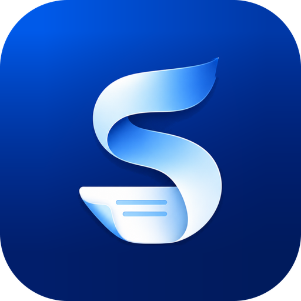
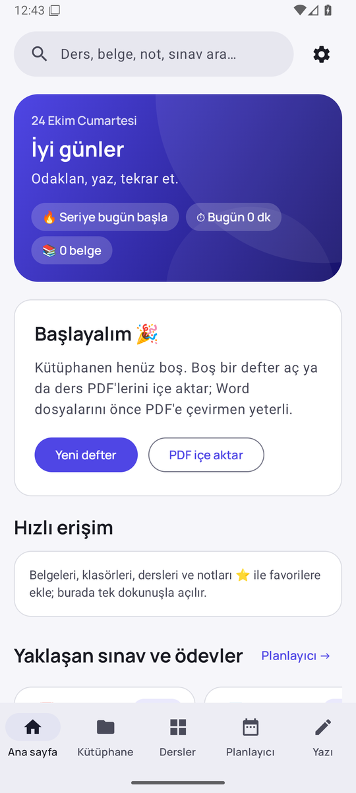
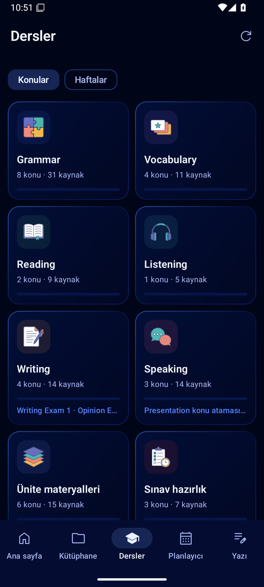
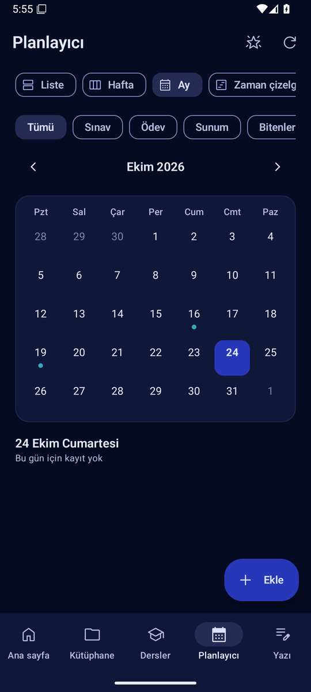
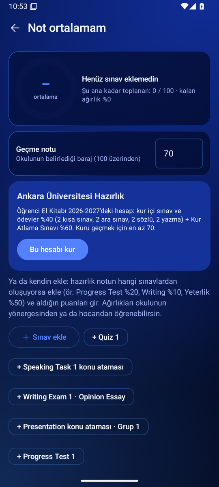

  

<h1 align="center">SouNote</h1>

  <b>Ders notların, kalemin ve sınavların tek yerde.</b> 
  PDF'lerin üstüne kalemle yaz, haftalık kaynaklarını ve sınav takvimini takip et. Ücretsiz, reklamsız Android uygulaması.

  <a href="https://github.com/uckankeskinkaya/SouNote/releases/latest/download/SouNote.apk"><b>⬇ APK'yı indir</b></a>
  ·
  <a href="https://uckankeskinkaya.github.io/SouNote/">İndirme sayfası</a>
  ·
  <a href="https://github.com/uckankeskinkaya/SouNote/releases">Tüm sürümler</a>

  
  
  
  

## Özellikler

| | |
|---|---|
| 🎨 **Görünüm (4.0)** | Sade, düz arayüz: kâğıt tonu açık tema ve kömür grisi koyu tema, tek vurgu rengi (6 tema), parıltı ve degrade yok; dört bölüm: Bugün, Kütüphane, Çalış, Takvim (tablette sol menü, altta Asistan ve Ayarlar; telefonda alt çubuk); her öğede simge |
| 🏠 **Ana sayfa** | Bölümleri sırala ya da gizle; favoriler ve sabitlenenlerle hızlı erişim; son kullanılanları tek tek kaldır ya da temizle (dosyalar silinmez) |
| **Bugün derste kartı** | Bugün ekranında o günün konuları ve PDF'leri: aç / indir / hepsini indir; ses kayıtları için Dinle |
| ✍️ **Kalem** | 14 kalem (dolma, jel, ince uç, keçeli, pastel, neon, noktalı, fırça, kaligrafi…), her kalem ayarını hatırlar; yazma desteği (titreme süzme), cetvel ve açıölçer, çıkartmalar, son kullanılan renkler, katmanlar (gizle/göster, sıra), sonsuz tuval; fosforlu, silgi, şekil düzeltme, lasso, metin kutusu, resim, avuç içi engelleme; Hızlı kalem halkası: kalemle sayfada kıpırdatmadan basılı tut, kalem, fosforlu, silgi ve son renkler halkası açılsın (Ayarlar → Not alma'dan kapatılır) |
| 📄 **PDF** | Okuma modu, lasso ile seçilen bölgeyi asistana sor, tablette yan yana not; içe aktar ya da klasör bağla, yakınlaşınca net çizim, form doldurma, PDF içinde arama, notlu PDF olarak dışa aktar; Kayıtlı çalışma düzeni: belge ekranında ⋮ → "Çalışma düzenini kaydet" ile belge + yan belge + dinleme kaydını sakla, Bugün ekranında tek dokunuşla aç |
| **Not geçmişi** | Sayfa notlarının eski sürümleri birkaç dakikada bir saklanır (sayfa başına 15); belge ekranı ⋮ → Not geçmişi → Geri yükle; geri al ile vazgeçilir |
| 📚 **Dersler** | Drive'daki ders klasörüne eklenen yeni hafta ve dosyalar uygulamaya kendiliğinden gelir ("Yeni gelenler"); haftalık kaynaklar konu ve hafta hafta; Word/PowerPoint dosyaları WPS/Office'te açılır, PDF olarak SouNote'a paylaşılır; bitirdiklerini işaretle, haftanın ilerlemesini gör |
| 📅 **Takvim** | Her sınavın türü simgeyle (sınav, Writing, Speaking, sunum, Listening, ödev, kur atlama); liste, hafta, ay ve zaman çizelgesi; ödev tamamlama, öncelik, filtreler, hatırlatıcılar, ana ekran widget'ları (sıradaki sınav, bugün, hafta listesi, hızlı işlemler); asistanla sınav öncesi gün gün çalışma planı |
| 🧠 **Asistan soruları** | Deneme sınavı ve alıştırmalar okulun sınav tarzında; aynı şıklar ve tekrar eden sorular ayıklanır, her soru ikinci kez çözülüp denetlenir, doğru cevap şıklara dağılır; ağır işlerde en güçlü model |
| 🃏 **Bilgi kartları** | Sayfadan seçip karta çevir ya da asistana ürettir; dokun çevir, kaydırarak bildim/bilemedim; aralıklı tekrar (Leitner) |
| 🤖 **Asistan** | Açık belgeyi ya da bir dersin bütün PDF'lerini okur (ders özeti); özet, kelime listesi, soru, essay değerlendirmesi. Evren (e-Devlet) anahtarı için uygulama içinde adım adım kurulum |
| 🔎 **Genel arama** | Dersler, klasörler, belgeler, notlar, sınavlar; PDF'lerin içinde sayfa sayfa; filtreler ve son aramalar |
| 🖋️ **Yazı stüdyosu** | Essay şablonu, başlık/kalın/italik, kelime ve karakter sayacı, odak modu, yapı paneli; yazma koçu önerir, sen onaylarsın |
| ✍️ **Writing pratiği** | Opinion essay/paragraph yaz; asistan L4 ölçütleriyle 100 üzerinden puanlar, hataları ve geliştirilmiş hali gösterir |
| 🔥 **Çalışma serisi** | Art arda çalıştığın günler; belgede 5 dk, kart tekrarı, Writing, haftalık liste ya da yazılı not o günü sayar |
| 🗺️ **Konu haritası** | Dersin konuları tek ekranda; kaynak ilerlemesi ve deneme puanına göre başlanmadı / çalışılıyor / hazır |
| 🎤 **Speaking pratiği** | Konu seç, hazırlan, konuş; cihaz konuşmanı yazıya döker, asistan L4 ölçütleriyle puanlar, örnek cevap verir |
| 🎧 **Listening pratiği** | Ders kayıtları uygulamada çalar: 0,75×–1,5× hız, 5 sn geri/ileri, tekrarla, kaldığın yer; dinlerken zaman damgalı not, asistanla alıştırma; çalışma kâğıdını dinlerken aç, ses üstteki çubukta sürer; A–B bölüm tekrarı: A ve B'yi işaretle, bölüm tekrar tekrar çalsın; tekrarlar arası 0/2/4/8 sn bekleme |
| 📥 **Haftayı toplu indir** | Dersler → Haftalar'da "Hepsini indir": haftanın bütün PDF'leri kütüphanene iner, internetsiz açılır; kütüphanedeki kaynaklar listede işaretli |
| 🎯 **Sınav günü kartı** | Sınavdan önceki gün ana sayfada: sınava giren konular, PDF'leri (hepsini indir), deneme sınavı ve kart tekrarı |
| 🤝 **Not birleştirme** | Arkadaşından gelen .sounote paketindeki belge sende de varsa notları kendi notlarına ayrı bir katman olarak eklenir; seninkilere dokunulmaz |
| 🖊️ **Kalem düğmesi** | Kalemin yan düğmesine bas: kalem ile silgi arasında hızlı geçiş (Xiaomi Focus Pen, S Pen, USI kalemler) |
| 📝 **Hafta ve konu özeti** | Haftalar'da ve konu kartında "Özet": asistan o hafta ya da konunun PDF'lerinden tek sayfalık özet çıkarır, notlara kaydedilir |
| 🧠 **Model seçimi** | Asistan Gelişmiş ayarlarında Evren modelleri: Otomatik, Önerilen, DeepSeek, GLM, Qwen… düğmeleri |
| 🪟 **Yan yana belge** | Tablette ikinci bir belgeyi yanda aç: solda defterine yaz, sağda ders PDF'ini oku |
| 📝 **Alıştırma** | Asistan konudan, açık belgeden ya da nottan alıştırma hazırlar (çoktan seçmeli, boşluk doldurma, yeniden yazma, açık uçlu); cevabı dokununca göster ya da önce cevapla, asistan değerlendirsin |
| **Deneme sınavı** | Dersin konularından asistan çoktan seçmeli test hazırlar (5/10/20 soru); sonuç ve yanlışların açıklaması; Konu analizi: ders geneli testte her soru bir konuya bağlanır; sonuçta konu konu doğru/toplam, zayıf konu üstte; konunun PDF'ini aç, o konudan alıştırma yap; konu puanları konu haritasına yazılır |
| **Kaynakta göster** | Ders metni varsa deneme sınavı soruları dayandıkları kısa alıntıyla gelir; yanlış soruda PDF'te o cümlenin sayfasını aç |
| 🔁 **Bugünkü tekrar** | Bütün belgelerde zamanı gelen bilgi kartları tek oturumda |
| 📊 **Not ortalaması** | Puanlarını gir, geçmek için kalan sınavlardan kaç alman gerektiğini gör |
| 📝 **Yazılı notlar** | Klavyeyle ya da kalemle yazma, yapılacaklar, çizim alanı |
| 📓 **Defterler** | Kapak seç; düz, çizgili, kareli, noktalı, Cornell, renkli Cornell, haftalık plan, kelime defteri, milimetrik, müzik, izometrik |
| 📦 **Paylaşma** | Notlu belgeyi `.sounote` paketi olarak gönder; arkadaşında notlarıyla açılır |
| ☁️ **Yedek** | Otomatik günlük yedek, Drive'a yedek, geri yükleme |

## Kurulum

1. [SouNote.apk](https://github.com/uckankeskinkaya/SouNote/releases/latest/download/SouNote.apk)'yı indir.
2. Dosyaya dokun; "bilinmeyen uygulamalar" uyarısında bu kaynağa izin ver.
3. Play Protect "güvenli olmayan uygulama" derse **Diğer ayrıntılar → Yine de yükle**. İstersen önce APK'yı [VirusTotal](https://www.virustotal.com/gui/home/upload)'a yükleyip taratabilirsin.
4. **Yükle**'ye bas. Sonraki sürümleri uygulama kendisi haber verir; üstüne kurunca notlar silinmez.

Android 10 ve üstü, tablet ve telefon.

## Geliştirme

- Kotlin + Jetpack Compose, `compileSdk 36`, `minSdk 29`. PDF: Android `PdfRenderer` + [PdfBox-Android](https://github.com/TomRoush/PdfBox-Android).
- Her push'ta GitHub Actions APK'yı derler, emülatörde açıp ekranları gezerek **çökme testi** yapar; test geçerse [Releases](https://github.com/uckankeskinkaya/SouNote/releases)'a yükler.
- Ders kataloğu `app/src/main/assets/catalog.json` (`tools/make_catalog.py` ile üretilir); her sürümle birlikte yayınlanır, uygulama açılışta en yenisini çeker.
- İmza: eski anahtar herkese açık olduğu için v3 anahtar döndürmeyle yeni anahtara geçildi; yeni anahtar `keystore/sounote2.p12.enc` olarak şifreli, şifresi sadece GitHub Secrets'ta (`SIGNING_PASSWORD`). Eski sürümlerin üstüne güncelleme kurulur.
- Ayrıntılı teknik notlar: [`CLAUDE.md`](CLAUDE.md).
