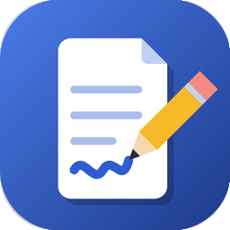
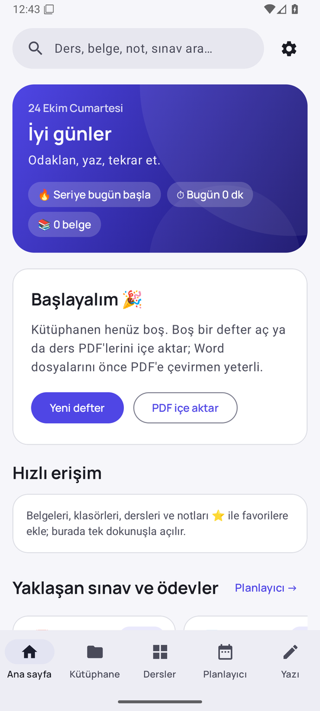
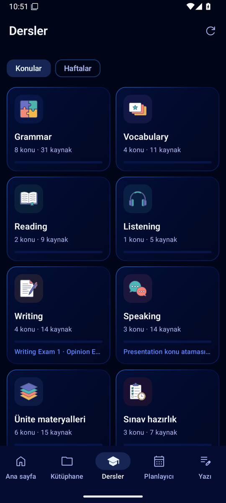
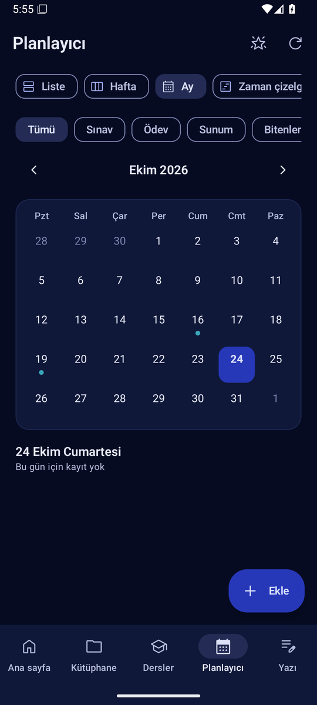
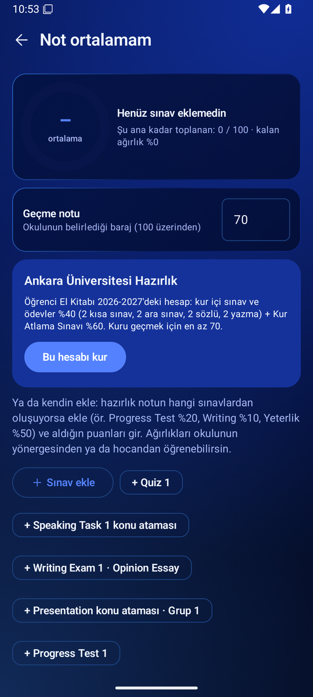

  

<h1 align="center">SouNote</h1>

  <b>Ders notların, kalemin ve sınavların tek yerde.</b> 
  PDF'lerin üstüne kalemle yaz, haftalık kaynaklarını ve sınav takvimini takip et. Ücretsiz, reklamsız Android uygulaması.

  <a href="https://github.com/uckankeskinkaya/SouNote/releases/latest/download/SouNote.apk"><b>⬇ APK'yı indir</b></a>
  ·
  <a href="https://uckankeskinkaya.github.io/SouNote/">İndirme sayfası</a>
  ·
  <a href="https://github.com/uckankeskinkaya/SouNote/releases">Tüm sürümler</a>

  
  
  
  

## Özellikler

| | |
|---|---|
| ✍️ **Kalem** | Basınca duyarlı kalem türleri, fosforlu, silgi, şekil düzeltme, lasso, metin kutusu, resim, avuç içi engelleme |
| 📄 **PDF** | İçe aktar ya da klasör bağla, yakınlaşınca net çizim, form doldurma, PDF içinde arama, notlu PDF olarak dışa aktar |
| 📚 **Dersler** | Haftalık kaynaklar konu ve hafta hafta; Word/PowerPoint dosyaları WPS/Office'te açılır, PDF olarak SouNote'a paylaşılır; bitirdiklerini işaretle, haftanın ilerlemesini gör |
| 📅 **Sınavlar** | Takvim, geri sayım, hatırlatıcı bildirimler, ana ekran widget'ı |
| 🃏 **Bilgi kartları** | Sayfadan seçip karta çevir ya da asistana ürettir; aralıklı tekrar (Leitner) |
| 🤖 **Asistan** | Açık belgeyi okur; özet, kelime listesi, soru, essay değerlendirmesi. Evren (e-Devlet) anahtarı için uygulama içinde adım adım kurulum |
| 🔎 **Genel arama** | PDF'lerin içinde sayfa sayfa, yazılı notlarda ve kartlarda |
| ✍️ **Writing pratiği** | Opinion essay/paragraph yaz; asistan L4 ölçütleriyle 100 üzerinden puanlar, hataları ve geliştirilmiş hali gösterir |
| 🔥 **Çalışma serisi** | Art arda çalıştığın günler; belgede 5 dk, kart tekrarı, Writing, haftalık liste ya da yazılı not o günü sayar |
| 🔁 **Bugünkü tekrar** | Bütün belgelerde zamanı gelen bilgi kartları tek oturumda |
| 📊 **Not ortalaması** | Puanlarını gir, geçmek için kalan sınavlardan kaç alman gerektiğini gör |
| 📝 **Yazılı notlar** | Klavyeyle ya da kalemle yazma, yapılacaklar, çizim alanı |
| 📦 **Paylaşma** | Notlu belgeyi `.sounote` paketi olarak gönder; arkadaşında notlarıyla açılır |
| ☁️ **Yedek** | Otomatik günlük yedek, Drive'a yedek, geri yükleme |

## Kurulum

1. [SouNote.apk](https://github.com/uckankeskinkaya/SouNote/releases/latest/download/SouNote.apk)'yı indir.
2. Dosyaya dokun; "bilinmeyen uygulamalar" uyarısında bu kaynağa izin ver.
3. Play Protect "güvenli olmayan uygulama" derse **Diğer ayrıntılar → Yine de yükle**. İstersen önce APK'yı [VirusTotal](https://www.virustotal.com/gui/home/upload)'a yükleyip taratabilirsin.
4. **Yükle**'ye bas. Sonraki sürümleri uygulama kendisi haber verir; üstüne kurunca notlar silinmez.

Android 10 ve üstü, tablet ve telefon.

## Geliştirme

- Kotlin + Jetpack Compose, `compileSdk 36`, `minSdk 29`. PDF: Android `PdfRenderer` + [PdfBox-Android](https://github.com/TomRoush/PdfBox-Android).
- Her push'ta GitHub Actions APK'yı derler, emülatörde açıp ekranları gezerek **çökme testi** yapar; test geçerse [Releases](https://github.com/uckankeskinkaya/SouNote/releases)'a yükler.
- Ders kataloğu `app/src/main/assets/catalog.json` (`tools/make_catalog.py` ile üretilir); her sürümle birlikte yayınlanır, uygulama açılışta en yenisini çeker.
- İmza anahtarları depoda tutulmaz, GitHub Secrets'tadır (`SOUNOTE_KEYSTORE_B64`, `SOUNOTE_OLD_KEYSTORE_B64`, `SOUNOTE_KEY_PASSWORD`). Anahtar v3 anahtar döndürmeyle değiştirildi; eski sürümlerin üstüne güncelleme kurulur.
- Ayrıntılı teknik notlar: [`CLAUDE.md`](CLAUDE.md).
